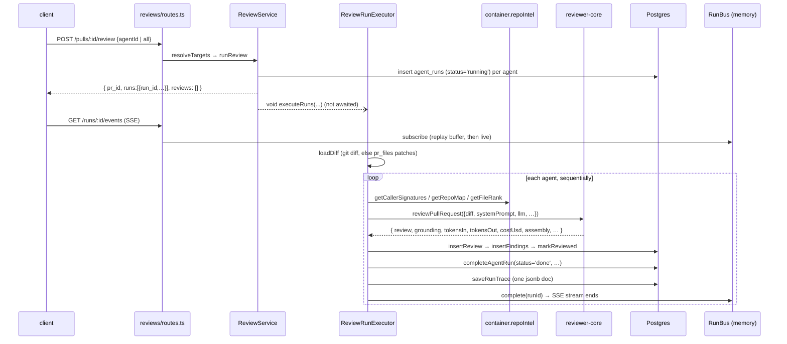
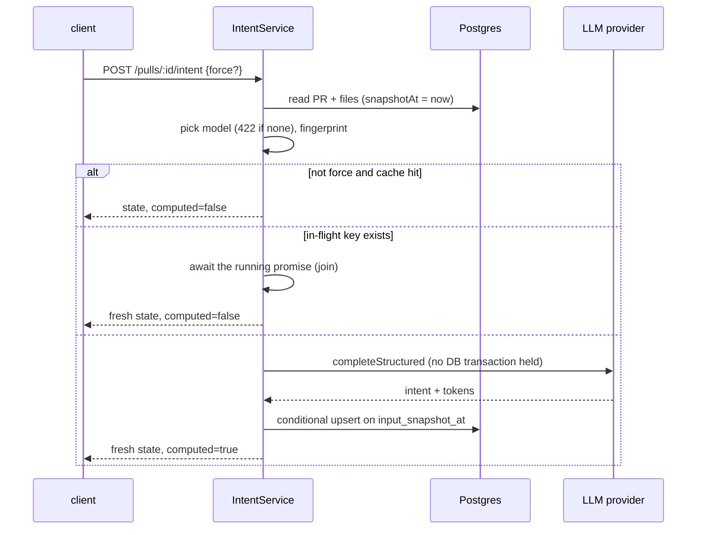

# Server architecture: from request to persisted review

Scope: how a review run actually executes today. Verified against the source on
2026-10-11. Labels used below:

- **Implemented**: current behaviour, with file references.
- **Potential bug**: found by reading the code, not reproduced by a test.

For env vars, the API map and the prompt-injection and grounding rationale, see
[../README.md](../README.md). Verified pitfalls are in [../INSIGHTS.md](../INSIGHTS.md).

## 1. Boot sequence (`src/app.ts`)

`buildApp(opts)` builds the Fastify instance. Tests call it directly and use `app.inject()`.

1. The zod validator and serializer compilers are set. Routes opt in with
   `withTypeProvider<ZodTypeProvider>()`.
2. `new Container(config, db, overrides)` is created and decorated as
   `app.container` (`src/app.ts:68`).
3. **Restart recovery.** `await new ReviewService(container).reapStaleRuns()`
   (`src/app.ts:81`) runs **before** any route is registered.
4. Plugins are registered: helmet, cors (origin = `WEB_PORT` web origin), the SSE
   plugin, and a global rate limit of 120/min (skipped when `NODE_ENV=test`,
   `src/app.ts:96`). The body limit is 1 MB (`src/app.ts:49`).
5. The error handler (`src/app.ts:116`) maps errors to responses:
   - zod failures → `422 validation_error`
   - response serialization errors → `500 internal_error`
   - `AppError` → its own `statusCode`
   - anything else → 500
6. Modules are registered from the static map in `src/modules/index.ts` (`src/app.ts:168`).

## 2. Dependency injection (`src/platform/container.ts`)

| Member | Lifetime | Notes |
|---|---|---|
| `config`, `db`, `secrets`, `auth`, `jobs` (JobRunner) | eager, per container | `secrets`/`auth` overridable |
| `runBus` | **process-wide singleton** (`src/platform/sse.ts`, exported `runBus`) | shared by every container in the process, tests included |
| `git`, `codeIndex`, `repoIntel`, `depgraph`, `tokenizer` | lazy getters | each overridable |
| `agentsRepo`, `reviewRepo`, `priceBook` | lazy getters | not overridable |
| `github()` | async, cached | throws `ConfigError` without `GITHUB_TOKEN` |
| `llm(id)` | async, cached per provider id | throws `ConfigError` when that provider's key is missing |
| `embedder()` | async | throws unless `EMBEDDINGS_ENABLED=true` |

- `invalidateSecretCaches()` drops the cached LLM, GitHub and embedder clients
  after a key changes.
- **LLM providers:**
  - OpenAI and Anthropic adapters live in `src/adapters/llm/`.
  - The OpenRouter provider comes from reviewer-core and gets
    `priceBook.estimate` injected as its cost fallback.
- **Services:** they are not stored in the container. Routes construct them with
  `new XService(container)` (see [modules.md](modules.md)).

## 3. Review execution flow

Step by step (all **implemented**):

1. **Route.** `src/modules/reviews/routes.ts:27-44`.
   - Params are validated with `IdParams`.
   - The body is parsed by hand with `RunRequest.parse(req.body ?? {})`, so an
     empty body is accepted.
   - Per-route rate limit: 10/min.
2. **Targets.** `ReviewService.resolveTargets` (`src/modules/reviews/service.ts`):
   - `all: true` → every enabled agent;
   - `agentId` → that one agent;
   - neither → `400 invalid_run_request`.
3. **Run rows.** `runReview` creates one `agent_runs` row per agent, inserted directly as
   `'running'` with `provider` and `model` (`repository/run.repo.ts:116`). There is no `queued` state.
4. **Background start.** `void this.executor.executeRuns(...)`: review runs do not go
   through `JobRunner`. A crash in `executeRuns` is only logged.
5. **Pre-work** (`src/modules/reviews/run-executor.ts:55-105`).
   - A single `RunLogger` fans events out to every queued run.
   - `loadDiff` (`src/modules/reviews/diff-loader.ts:12`) tries
     `git diff base...head` and falls back to rebuilding the diff from `pr_files` patches.
   - If the diff fails to load, every queued run is marked `failed` (`failAll`).
6. **Per agent, sequentially** (`runOneAgent`, `run-executor.ts:138`):
   - `container.llm(agent.provider)` resolves the provider. A missing key makes the run `failed`.
   - repo-intel enrichment runs when the agent's `repo_intel` flag is not `false`.
     It covers the callers digest, the repo map, and the "top 5%" rank note. Each
     piece is best-effort and any error is swallowed into an info log line.
   - `reviewPullRequest(...)` (`run-executor.ts:190`) is called with `strategy: agent.strategy ?? 'single-pass'`.
   - reviewer-core assembles the prompt (adding `INJECTION_GUARD`), calls
     `completeStructured` with parse-with-repair retries, reduces, grounds findings
     against the diff, and recomputes the score from the findings it kept.
     Cancellation is only checked between chunks (`reviewer-core/src/review/run.ts:164`).
7. **Persist** (`run-executor.ts:218-287`), in this order:
   1. `insertReview`
   2. `insertFindings` (kept findings only)
   3. `markReviewed(headSha)`
   4. `completeAgentRun`: status, duration, tokens, findings count, grounding,
      score, and `blockers = countBlockers(findings, agent.ciFailOn)`
   5. `saveRunTrace`
   6. `runBus.complete`
8. **Failure or cancel** (`run-executor.ts:290-313`).
   - The run row gets `failed` or `cancelled`, the error text, and
     **`tokensIn/out = 0`**, even when LLM calls already happened.
   - A minimal trace built from the event buffer is saved.
   - Every DB write here uses `.catch(() => undefined)`.

Agents run one after another; one agent failing does not stop the others.

## 4. RunBus, RunLogger and SSE

- **`RunBus`** (`src/platform/sse.ts`) keeps per-run state in memory: emitter,
  event buffer, `seq`, `completed`, `cancelled`.
  - `publish` stamps `seq` and the `t` time (HH:MM:SS) on each event.
  - `subscribe` replays the buffer before going live.
  - `onDone` fires immediately for runs that already completed.
- **`RunLogger`** (`src/platform/run-logger.ts:36`) is the one place run events
  should be written. It mirrors them to pino, and `step()` wraps work in
  "label…" / "label done (Nms)" events. `forRun()` narrows a fanned-out logger to one run.
- **SSE route** `GET /runs/:id/events` (`routes.ts:48-92`) bridges the bus to an
  async generator. Each event is sent as `id = seq`, `event = kind`,
  `data = JSON(RunEvent)`, and the stream ends on `done`. It has no rate limit.
- **Related routes:**
  - `GET /pulls/:id/runs/active`: DB rows with `status='running'`, the source of truth for the UI.
  - `GET /pulls/:id/runs`: the run history as `RunSummary[]`.
  - `POST /runs/:id/cancel`
  - `DELETE /runs/:id`: also deletes the review that run produced.
  - `GET /runs/:id/trace`

## 5. Persistence model (review domain)

| Table | Written by | Content |
|---|---|---|
| `agent_runs` (`src/db/schema/runs.ts`) | `createAgentRun`, `completeAgentRun` | per-run metrics. `status` is free text (no enum or check). **No cost column**: `cost_usd` was dropped by migration `0009`. |
| `run_traces` | `saveRunTrace` (upsert, PK = run id) | the whole `RunTrace` as one jsonb document |
| `reviews`, `findings` | `insertReview`, `insertFindings` | verdict, summary, score, model; only findings that passed grounding |
| `pr_intent` (`src/db/schema/reviews.ts`) | `saveIntent` (conditional upsert, PK = PR id) | stored PR intent, fingerprint, model, prompt version, tokens, cost. See [section 8](#8-pr-intent-l03-intent-block-p1-backend) |

`ReviewRepository` (`src/modules/reviews/repository.ts`) is a facade class over
the function-style `repository/*.repo.ts` files.

## 6. Restart recovery and cancel semantics

- **Implemented.** On boot, `reapStaleRunningRuns` flips every `'running'` row to `'failed'`
  (`repository/run.repo.ts:104`). It assumes a single API instance per DB.
  Reaped rows get no `error`, no duration and no trace.
- **Implemented.** After a restart the in-memory bus is empty, so an SSE
  subscriber to an old run gets no replay and no `done`.
- **Potential bug (in [../INSIGHTS.md](../INSIGHTS.md)).**
  1. `cancelRun` calls `runBus.cancel`, then `cancelRunIfRunning`, then `runBus.complete`.
  2. `complete()` deletes the cancel flag again.
  3. The runner therefore usually keeps going.
  4. Because `completeAgentRun` has no `status='running'` guard, it can then overwrite
     `cancelled` with `done`.
- **Potential bug.** `RunBus.complete()` says "release buffers" in its comment, but
  it never deletes `buffers`, `seq` or `completed` entries
  (`src/platform/sse.ts:76-83`). Memory grows with every run for the life of the process.

## 7. Unused helpers (exist, not wired)

- `src/platform/trace-builder.ts`: a zod-validated trace builder, not imported anywhere.
- `src/platform/model-router.ts`: `routeModel` and `PromptCache`, not imported by the review flow.

## 8. PR intent (L03 Intent block, P1 backend)

**Implemented.** A short, model-generated statement of what a PR is for. It is a
separate flow from review runs: no `agent_runs` row, no `RunBus`, no SSE. Code is in
`src/modules/reviews/intent/` (`constants`, `failures`, `fingerprint`, `freshness`, `prompt`,
`model`, `service`) plus `repository/intent.repo.ts`.

### Endpoints (`src/modules/reviews/routes.ts:135-148`)

| Route | Behaviour |
|---|---|
| `GET /pulls/:id/intent` | Returns `PrIntentState`. A pure local read of DB, settings and the secrets store: **no LLM call, no network, no GitHub sync** (`intent/service.ts:126`). Carries `current_model` and `model_error` (the 422 text as data, instead of throwing). |
| `POST /pulls/:id/intent` body `{force?}` | Returns `PrIntentState` plus `computed` (`false` on a cache hit). Rate limit 10/min. An empty body is accepted (`IntentRunRequest.parse(req.body ?? {})`). |

Errors of `POST` (all messages are fixed; raw provider text is never returned or logged,
`intent/failures.ts`): `404` for an unknown or foreign-workspace PR; `422
intent_model_unavailable` when no model is usable; `409 intent_inputs_incomplete` when the
PR's files are not stored locally and there is no stored intent for the current head (also
with `force`: it means "ignore the cache", not "accept incomplete input"); `502
external_service_error` with a fixed message for provider 401/403, 429, invalid output or
any other provider error; `504 intent_timeout` when this caller's wait (60 s,
`INTENT_TIMEOUT_MS`) elapsed. The provider call is **not** aborted on `504`: it keeps
running, its result is still saved and visible via `GET`. On failures the stored intent is
left unchanged. Failures are logged with safe fields only (error name, HTTP status, short
code, provider, model, prId).

### Model choice (`intent/model.ts:29`)

1. `settings.feature_models.review_intent` override, used as-is. If its provider has no
   key the result is `422`; there is no substitution.
2. Otherwise the `onboarding` feature model (its override, else its registry default),
   if its provider has a key. `source` is `fallback_onboarding`.
3. Otherwise `422` with the hint "Settings > Models > PR Review · Intent".

The registry default of `review_intent` (`openai/gpt-4.1`) is never used. The key check
is local: `container.llm(provider)` builds the client from the stored key and a
`ConfigError` means "no key" (`intent/service.ts:60-67`).

### Fingerprint and freshness

- **Fingerprint v1** (`intent/fingerprint.ts:50-68`): sha256 over canonical JSON of
  `v`, normalized `title` and `body` (CRLF→LF, trimmed), `head_sha`, `base`, and `files`
  sorted by path, each as `{path, hunks}` where `hunks` are the full `@@ … @@` header
  lines including function context. `files` is `null` (unknown) whenever no `pr_files`
  are stored (`knownFiles`): absence of rows never means "no files", because the list sync
  stores `files_count: 0` for every imported PR. Intents are never computed or saved from
  an unknown file list.
- **Model and prompt version are not in the fingerprint.** They are stored in their own
  columns so staleness can name the reason. Bump `INTENT_PROMPT_VERSION`
  (`intent/constants.ts:9`, currently `intent-v2`) whenever the prompt or output schema
  changes.
- **Freshness** (`intent/freshness.ts:41-54`):
  - `unknown`: no stored row, or no stale reason but the file data is not synced.
  - `stale` with reasons `pr_changed` (fingerprint differs; with unknown files only a
    different `head_sha` counts), `prompt_changed`, `model_changed`. A legacy row with
    NULL fingerprint or NULL prompt version is stale.
  - `fresh`: none of the above and files known.
- **Cache hit** (`isCacheHit`): `POST` without `force` skips the model when the row is
  `fresh`. With unknown files `POST` never calls the model: a stored intent with the same
  `head_sha` is returned as-is (`computed: false`, freshness `unknown`), otherwise `409`.
  `resolveForRun` follows the same rule (stored intent or `null`, never computes).

### Concurrency

- **Single-flight** (`intent/service.ts`, `inflight` / `run` / `waitFor`): a process-wide
  map keyed by `prId|fingerprint|provider|model|prompt_version`. The flight is the whole
  work (LLM call → validate → conditional save) with **no timeout**; each HTTP caller
  (originator or joiner) waits for it through `withTimeout`. The entry is removed only by
  the flight's own `finally`, so a retry after a caller timeout joins the running call
  instead of paying twice, `force` included. A different key computes separately. Single
  API instance assumed. It does not go through `container.jobs`. There is no true
  cancellation (that needs an abort signal in reviewer-core); the flight is bounded only by
  the provider SDK's own timeout/retries.
- **Provider timeout is disabled on purpose.** The service passes `timeoutMs: 0`
  (`INTENT_PROVIDER_TIMEOUT_MS`) so the OpenAI/Anthropic adapters skip their outer 60 s
  `withTimeout` race (`platform/resilience.ts`: `ms <= 0` returns the promise unchanged).
  Otherwise the flight would settle at 60 s while the SDK request kept running and billing,
  and a retry after `504` would start a second paid call. Consequence: the provider request
  may run long (SDK defaults: about 10 min × retries for OpenAI/Anthropic, 90 s × retries
  for OpenRouter); meanwhile identical requests (including `force`) join it and get `504`
  until it ends. Cancelling the HTTP wait does **not** cancel the provider request and does
  not guarantee no billing; real cancellation needs an adapter change (separate approval).
- **Snapshot at read.** Inputs are read once with `snapshotAt`
  (`repository/intent.repo.ts:32-42`). The row is saved with the fingerprint of the input
  actually sent, and `input_snapshot_at = snapshotAt`.
- **Older never overwrites newer.** `saveIntent` is an `INSERT … ON CONFLICT (pr_id) DO UPDATE`
  guarded by `input_snapshot_at IS NULL OR input_snapshot_at <= excluded.input_snapshot_at`
  (`intent.repo.ts:67-91`); it returns `false` when a newer snapshot already holds the row.
- **No DB transaction** is held across the LLM call.
- After the call the response is rebuilt from the **current** state, so a PR edited
  during the call reports `stale` (`pr_changed`) (`service.ts:165-167`).

### Cost

Tokens and cost are stored on `pr_intent` (`tokens_in`, `tokens_out`, `cost_usd`; cost is
the provider value, else `priceBook.estimate`, `service.ts:206`). They are **not** written
to `agent_runs` and are not part of run cost.

### Schema

Migration `0012_breezy_genesis.sql` adds to `pr_intent`: `risk_areas` (jsonb, default
`[]`), `confidence`, `input_fingerprint`, `prompt_version`, `provider`, `model`,
`head_sha`, `input_snapshot_at`, `generated_at` (default `now()`), `tokens_in`,
`tokens_out`, `cost_usd`. The contract field `Intent.risk_areas` is optional
(`vendor/shared/contracts/brief.ts:17`).

### Review prompt integration (P3)

`ReviewService` builds `ReviewRunExecutor` with an `IntentService` (`service.ts`). In `executeRuns`, after
"Diff ready" and before the agents loop, the executor calls `resolveForRun` **once** for all queued runs
(`resolveIntent`, `run-executor.ts`). A stored non-stale intent is reused with no model call; otherwise it is
generated first (the first run can wait for that call before agents start). The result is mapped by
`toPromptIntent` (`intent/for-run.ts`) and passed to `reviewPullRequest` for every agent; reviewer-core renders
it as an untrusted `## PR intent` block plus a system policy (see `reviewer-core/docs/architecture.md` §3) and
records it as `PromptAssembly.intent`. Intent is context only: nothing filters findings by it.

- **Failure is soft.** `null`/throw → `info` line `intent: unavailable — continuing without intent` (+ a server
  `warn`), prompt unchanged. No `error` event and no provider error text reaches the Live Log.
- **Cost.** The intent generation is billed to the intent feature (`pr_intent.cost_usd`), not to the review run:
  `stats.cost_usd` and token counts come only from the review calls. The Live Log says `billed separately`.
- **No resolver** (3-arg construction, e.g. in tests) → the step is skipped entirely.
- Only explicit Run Review reaches this path (`executeRuns`); opening a PR page never starts a model call.

### Context sources (L03 context, migration `0013`)

Besides the title, description and file list, the intent prompt (`INTENT_PROMPT_VERSION`
`intent-v2`) gets an untrusted `pr_context` block built by `intent/context.ts`:

| Source | Where it comes from | Status |
|---|---|---|
| Linked issues | `#N`, `owner/repo#N` and `github.com/owner/repo/(issues\|pull)/N` of the PR's **own** repo in the description; at most `INTENT_MAX_ISSUES` (3), the PR's own number excluded | `confirmed` (fetched via `container.github().getIssue`), `unavailable` (`not_found_or_no_access` / `github_unavailable` / `fetch_failed`), `unverified` (`over_limit`) |
| Ticket / plan links | Any other `http(s)` URL in the description, classified by host (Jira, Linear, Notion, Google Docs, …) and reduced to scheme + host + path (credentials, query, fragment dropped) | always `unverified` / `not_fetched` — **no URL from a PR is ever requested** |
| Planning docs | Changed files that look like plans (`plans/`, `specs/`, `rfcs/`, `adr/`, `design`, `*plan*.md`, …): their **added lines** from the stored patch; paths mentioned in the description but not in the diff | `confirmed` (`truncated` when clipped), `unavailable` (`no_patch`), `unverified` (`not_in_diff`) |
| Title / description | `pull_requests` | `confirmed`, or `missing` (`empty`) |

- **GET stays local.** Issues are fetched only by `POST` (and `resolveForRun`), in
  parallel, each bounded by `INTENT_ISSUE_FETCH_TIMEOUT_MS`. Errors are mapped to fixed
  codes; GitHub error text and tokens never reach the prompt, the DB or the response.
- **Stored** in `pr_intent.context_sources` (jsonb, nullable; `null` = intent generated
  before context existed): one record per source with status/note, the issue title and a
  `content_hash` of each confirmed issue — never issue bodies or document text.
  `PrIntentState.context_sources` returns them (without the hash); the Intent block
  lists them and the gaps ("no linked issue", "N references not verified", …).
- **Freshness.** Local context (refs parsed from the description, plan-doc text hashes)
  is part of the fingerprint, added only when a PR has any context so older fingerprints
  of context-free PRs stay valid. Issue text cannot be checked by `GET`; a `POST`
  re-fetches the issues and treats the stored intent as a cache hit only when the issue
  statuses and content hashes match (the hash is also part of the single-flight key).
- **Budget.** Issue bodies ≤ 1 500 chars, plan docs ≤ 2 000, links ≤ 10, whole block ≤
  `INTENT_CONTEXT_MAX_CHARS` (6 000); dropped entries are counted in the prompt.

## 9. Smart Diff (L03, `GET /pulls/:id/smart-diff`)

A local read (stored `pr_files` + findings; no GitHub, no LLM), workspace-scoped through
`getPull` (404 for an unknown or foreign PR, 422 for a malformed id). Built by the pure
`buildSmartDiff` (`src/modules/reviews/smart-diff.ts`) and returned as `SmartDiff`:

- **Groups.** All five roles in `SMART_GROUP_ORDER` (`core, tests, wiring, docs,
  boilerplate`), files sorted by path, one entry per path. Classification uses the shared
  rules module `vendor/shared/smart-diff-rules.ts` — the same file the client's Smart
  order uses (`client/src/lib/smart-diff.ts`). Priority: boilerplate → tests → wiring →
  docs → core. The client copy must be byte-identical; `test/smart-diff-rules-sync.test.ts`
  fails otherwise.
- **Findings.** Those of the latest completed review of each agent (the PR-list summary
  selection, `ReviewRepository.inlineFindings`). Each is anchored like the diff viewer
  does: `end_line` when it is a rendered new-side line, else the largest rendered line in
  the range. `finding_lines` lists the anchors (ascending, unique); `findings_count` and
  `unanchored_findings` count per file (line 0 / negative / off the changed side / no
  patch); `findings_outside_diff` counts findings on files not in the diff.
- **split_suggestion.** `total_lines` = additions + deletions of non-boilerplate files;
  `too_big` above `SMART_DIFF_SPLIT_THRESHOLD_LINES` (400). Proposed splits: one per
  non-empty non-boilerplate role; with a single role, by the first two directory segments;
  none when everything sits in one role and one directory.
