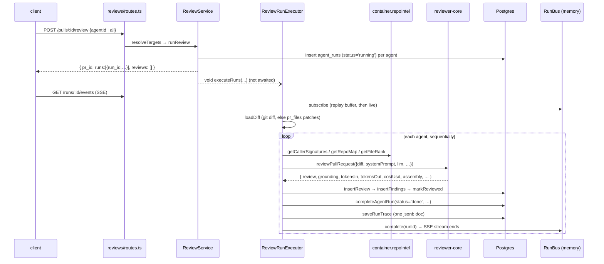

# Server architecture: from request to persisted review

Scope: how a review run actually executes today. Verified against the source on
2026-10-11. Labels used below:

- **Implemented**: current behaviour, with file references.
- **Potential bug**: found by reading the code, not reproduced by a test.

For env vars, the API map and the prompt-injection and grounding rationale, see
[../README.md](../README.md). Verified pitfalls are in [../INSIGHTS.md](../INSIGHTS.md).

## 1. Boot sequence (`src/app.ts`)

`buildApp(opts)` builds the Fastify instance. Tests call it directly and use `app.inject()`.

1. The zod validator and serializer compilers are set. Routes opt in with
   `withTypeProvider<ZodTypeProvider>()`.
2. `new Container(config, db, overrides)` is created and decorated as
   `app.container` (`src/app.ts:68`).
3. **Restart recovery.** `await new ReviewService(container).reapStaleRuns()`
   (`src/app.ts:81`) runs **before** any route is registered.
4. Plugins are registered: helmet, cors (origin = `WEB_PORT` web origin), the SSE
   plugin, and a global rate limit of 120/min (skipped when `NODE_ENV=test`,
   `src/app.ts:96`). The body limit is 1 MB (`src/app.ts:49`).
5. The error handler (`src/app.ts:116`) maps errors to responses:
   - zod failures → `422 validation_error`
   - response serialization errors → `500 internal_error`
   - `AppError` → its own `statusCode`
   - anything else → 500
6. Modules are registered from the static map in `src/modules/index.ts` (`src/app.ts:168`).

## 2. Dependency injection (`src/platform/container.ts`)

| Member | Lifetime | Notes |
|---|---|---|
| `config`, `db`, `secrets`, `auth`, `jobs` (JobRunner) | eager, per container | `secrets`/`auth` overridable |
| `runBus` | **process-wide singleton** (`src/platform/sse.ts`, exported `runBus`) | shared by every container in the process, tests included |
| `git`, `codeIndex`, `repoIntel`, `depgraph`, `tokenizer` | lazy getters | each overridable |
| `agentsRepo`, `reviewRepo`, `priceBook` | lazy getters | not overridable |
| `github()` | async, cached | throws `ConfigError` without `GITHUB_TOKEN` |
| `llm(id)` | async, cached per provider id | throws `ConfigError` when that provider's key is missing |
| `embedder()` | async | throws unless `EMBEDDINGS_ENABLED=true` |

- `invalidateSecretCaches()` drops the cached LLM, GitHub and embedder clients
  after a key changes.
- **LLM providers:**
  - OpenAI and Anthropic adapters live in `src/adapters/llm/`.
  - The OpenRouter provider comes from reviewer-core and gets
    `priceBook.estimate` injected as its cost fallback.
- **Services:** they are not stored in the container. Routes construct them with
  `new XService(container)` (see [modules.md](modules.md)).

## 3. Review execution flow

Step by step (all **implemented**):

1. **Route.** `src/modules/reviews/routes.ts:27-44`.
   - Params are validated with `IdParams`.
   - The body is parsed by hand with `RunRequest.parse(req.body ?? {})`, so an
     empty body is accepted.
   - Per-route rate limit: 10/min.
2. **Targets.** `ReviewService.resolveTargets` (`src/modules/reviews/service.ts`):
   - `all: true` → every enabled agent;
   - `agentId` → that one agent;
   - neither → `400 invalid_run_request`.
3. **Run rows.** `runReview` creates one `agent_runs` row per agent, inserted directly as
   `'running'` with `provider` and `model` (`repository/run.repo.ts:116`). There is no `queued` state.
4. **Background start.** `void this.executor.executeRuns(...)`: review runs do not go
   through `JobRunner`. A crash in `executeRuns` is only logged.
5. **Pre-work** (`src/modules/reviews/run-executor.ts:55-105`).
   - A single `RunLogger` fans events out to every queued run.
   - `loadDiff` (`src/modules/reviews/diff-loader.ts:12`) tries
     `git diff base...head` and falls back to rebuilding the diff from `pr_files` patches.
   - If the diff fails to load, every queued run is marked `failed` (`failAll`).
6. **Per agent, sequentially** (`runOneAgent`, `run-executor.ts:138`):
   - `container.llm(agent.provider)` resolves the provider. A missing key makes the run `failed`.
   - repo-intel enrichment runs when the agent's `repo_intel` flag is not `false`.
     It covers the callers digest, the repo map, and the "top 5%" rank note. Each
     piece is best-effort and any error is swallowed into an info log line.
   - `reviewPullRequest(...)` (`run-executor.ts:190`) is called with `strategy: agent.strategy ?? 'single-pass'`.
   - reviewer-core assembles the prompt (adding `INJECTION_GUARD`), calls
     `completeStructured` with parse-with-repair retries, reduces, grounds findings
     against the diff, and recomputes the score from the findings it kept.
     Cancellation is only checked between chunks (`reviewer-core/src/review/run.ts:164`).
7. **Persist** (`run-executor.ts:218-287`), in this order:
   1. `insertReview`
   2. `insertFindings` (kept findings only)
   3. `markReviewed(headSha)`
   4. `completeAgentRun`: status, duration, tokens, findings count, grounding,
      score, and `blockers = countBlockers(findings, agent.ciFailOn)`
   5. `saveRunTrace`
   6. `runBus.complete`
8. **Failure or cancel** (`run-executor.ts:290-313`).
   - The run row gets `failed` or `cancelled`, the error text, and
     **`tokensIn/out = 0`**, even when LLM calls already happened.
   - A minimal trace built from the event buffer is saved.
   - Every DB write here uses `.catch(() => undefined)`.

Agents run one after another; one agent failing does not stop the others.

## 4. RunBus, RunLogger and SSE

- **`RunBus`** (`src/platform/sse.ts`) keeps per-run state in memory: emitter,
  event buffer, `seq`, `completed`, `cancelled`.
  - `publish` stamps `seq` and the `t` time (HH:MM:SS) on each event.
  - `subscribe` replays the buffer before going live.
  - `onDone` fires immediately for runs that already completed.
- **`RunLogger`** (`src/platform/run-logger.ts:36`) is the one place run events
  should be written. It mirrors them to pino, and `step()` wraps work in
  "label…" / "label done (Nms)" events. `forRun()` narrows a fanned-out logger to one run.
- **SSE route** `GET /runs/:id/events` (`routes.ts:48-92`) bridges the bus to an
  async generator. Each event is sent as `id = seq`, `event = kind`,
  `data = JSON(RunEvent)`, and the stream ends on `done`. It has no rate limit.
- **Related routes:**
  - `GET /pulls/:id/runs/active`: DB rows with `status='running'`, the source of truth for the UI.
  - `GET /pulls/:id/runs`: the run history as `RunSummary[]`.
  - `POST /runs/:id/cancel`
  - `DELETE /runs/:id`: also deletes the review that run produced.
  - `GET /runs/:id/trace`

## 5. Persistence model (review domain)

| Table | Written by | Content |
|---|---|---|
| `agent_runs` (`src/db/schema/runs.ts`) | `createAgentRun`, `completeAgentRun` | per-run metrics. `status` is free text (no enum or check). **No cost column**: `cost_usd` was dropped by migration `0009`. |
| `run_traces` | `saveRunTrace` (upsert, PK = run id) | the whole `RunTrace` as one jsonb document |
| `reviews`, `findings` | `insertReview`, `insertFindings` | verdict, summary, score, model; only findings that passed grounding |

`ReviewRepository` (`src/modules/reviews/repository.ts`) is a facade class over
the function-style `repository/*.repo.ts` files.

## 6. Restart recovery and cancel semantics

- **Implemented.** On boot, `reapStaleRunningRuns` flips every `'running'` row to `'failed'`
  (`repository/run.repo.ts:104`). It assumes a single API instance per DB.
  Reaped rows get no `error`, no duration and no trace.
- **Implemented.** After a restart the in-memory bus is empty, so an SSE
  subscriber to an old run gets no replay and no `done`.
- **Potential bug (in [../INSIGHTS.md](../INSIGHTS.md)).**
  1. `cancelRun` calls `runBus.cancel`, then `cancelRunIfRunning`, then `runBus.complete`.
  2. `complete()` deletes the cancel flag again.
  3. The runner therefore usually keeps going.
  4. Because `completeAgentRun` has no `status='running'` guard, it can then overwrite
     `cancelled` with `done`.
- **Potential bug.** `RunBus.complete()` says "release buffers" in its comment, but
  it never deletes `buffers`, `seq` or `completed` entries
  (`src/platform/sse.ts:76-83`). Memory grows with every run for the life of the process.

## 7. Unused helpers (exist, not wired)

- `src/platform/trace-builder.ts`: a zod-validated trace builder, not imported anywhere.
- `src/platform/model-router.ts`: `routeModel` and `PromptCache`, not imported by the review flow.
- The `pr_intent` read/write functions in `src/modules/reviews/repository/pull.repo.ts`.
